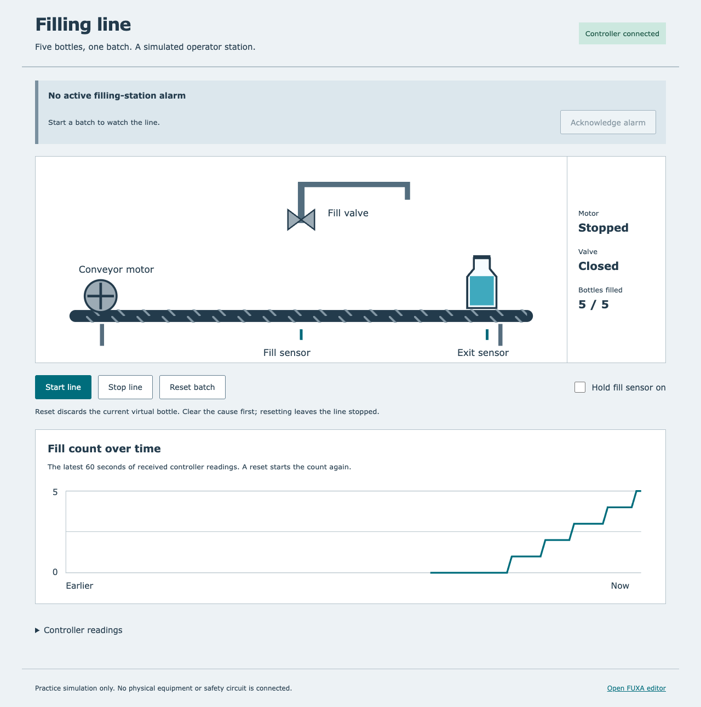

# PLC filling-line training bench

I built a bottle-filling simulator because I wanted to practise stopping a faulty line and getting it running again without needing physical equipment.

## Overview

Clearing an obstruction does not mean a conveyor should start moving again.
I wanted to see that distinction play out: what stops the motor and valve, what
keeps them off, and what I must do before starting a fresh batch.

In this personal project, I run five virtual bottles along a conveyor using a
browser control panel. I can watch them fill, stall the conveyor or open a guard.
Then I clear the cause, reset and start again. A maintenance log records the
repair work and opens a nozzle inspection order after a short practice interval.
I can also hold the fill sensor on to see how the controller handles a bottle
that appears not to leave the filling position.

I also wanted to trace each simulated sensor back to a numbered wire and watch
the controller from a separate operator screen. The project now includes a
panel-drawing generator and a second screen that reads the running controller
through a standard industrial connection. I can print the drawings, check the
parts list, and practise acknowledging a fault before resetting the line.

Follow the setup below, open **http://127.0.0.1:8765**, and press **Start line**.
The original panel shows the conveyor, valve, sensors and bottle count. For a
quick terminal walkthrough after building, run `python -m fillingline.practice`.
For the drawing exports and the separate operator screen, follow the two
sections below. Everything here is simulated; it does not connect to real equipment.

## Run locally

Requires Python 3.10+, Git and a C/C++ compiler. Install the build tools for your
operating system first. On Ubuntu / Debian:

```sh
sudo apt-get update
sudo apt-get install -y build-essential autoconf automake bison flex python3-venv git
```

On macOS (Apple Silicon Homebrew shown; install Xcode Command Line Tools for the
C/C++ compiler if needed):

```sh
brew install autoconf automake bison flex
export PATH="/opt/homebrew/opt/bison/bin:/opt/homebrew/opt/flex/bin:$PATH"
```

Then get the project and start the panel:

```sh
git clone https://github.com/jackaI1/plc-filling-line.git
cd plc-filling-line
python3 -m venv .venv
. .venv/bin/activate
python -m pip install -r requirements-dev.txt
python tools/build.py
python tools/validate_schema.py
python -m fillingline.server
```

Open **http://127.0.0.1:8765**. Stop with Ctrl+C. Use `--port 8766` if the default
port is occupied. Work orders persist in `.build/maintenance.sqlite3`; use
`--db /path/to/demo.sqlite3` for a separate log. That directory is ignored by Git.
The server accepts connections from this computer only.

The first build downloads the pinned OpenPLC tools into `.build/` and compiles
the controller. It does not install a background service. No Python packages are
needed by the running panel; the build tools use `lxml`.


## Try a fault and recovery

1. Press **Start line**. The conveyor stops each bottle under the valve for a
   one-second fill. The fifth bottle reaching the exit ends the batch.
2. While running, select **Stall conveyor**. After three seconds of commanded
   travel without an exit signal, the line trips and a corrective work order
   appears.
3. Clear the stall. The alarm stays latched until you press
   **Reset batch / discard bottle**. Reset clears the batch and removes the
   current simulated bottle; you must press **Start line** to run again.
4. Enter a resolution and close the work order. Closing an order records the
   work; it does not reset or start the line.
5. Try a low tank, open guard or emergency-stop input. The motor and valve turn
   off in the next simulation step. Reset cannot override an unhealthy input.

Stopping mid-fill also requires a reset and removal of the partly filled bottle.
After 30 seconds of accumulated running time, the log opens a preventive nozzle
inspection order. Stop the line, complete that order and acknowledge service.
This short interval makes the workflow easy to try; it is not a maintenance
recommendation for real equipment.

To follow the conveyor-stall recovery in the terminal instead:

```sh
python -m fillingline.practice
```

It prints the simulated time, motor and valve state, bottle count and work-order
status at each checkpoint. It clears the stall, closes the order, checks that
neither action restarts the line, then resets and starts a full five-bottle batch.
It runs the same compiled controller and plant as the browser, with an isolated
in-memory log. It opens no server and leaves the browser's saved work orders alone.

## Check a bottle that does not leave

I wanted a more useful warning than a general conveyor timeout when a filled
bottle stays under the nozzle. Select **Hold fill sensor on**, then **Start line**.
After the one-second fill, the controller allows one second for the bottle to
leave the sensor. If the signal stays on, it stops the motor and valve and shows
**Fill position did not clear**. The maintenance log opens one work order for
the filling station.

Pressing Reset while the sensor is still held on leaves the fault active, even
though Reset discards the virtual bottle. Release the checkbox, reset, then
start a new batch. Releasing the sensor or closing the work order alone leaves
the line stopped. This same check catches a conveyor stalled at the fill position.
It cannot tell a physical jam from a sensor reading stuck on; the message asks
me to check both.

To run this recovery in the terminal without starting a server:

```sh
python -m fillingline.practice --fault fill-sensor
```

The exercise checks the refused reset, releases the sensor, closes the work
order and completes a fresh five-bottle batch.

## Use the separate operator screen

I use FUXA, a free web-based operator interface, to watch the same compiled
controller through Modbus TCP, a common way for industrial devices to exchange
values over a network. This runs a separate simulated line from the original
maintenance panel. Its bottle, conveyor motor and valve follow the controller's
live values. The count trend shows how the batch progresses.

With Node.js 22 or 24 installed, install the screen's dependencies once:

```sh
npm --prefix scada ci --ignore-scripts=false
```

Then use two terminals from this folder, with the Python environment active:

```sh
# Terminal 1: controller, simulated plant and local Modbus connection
python -m fillingline.modbus
```

```sh
# Terminal 2: operator screen
npm --prefix scada start
```

Open **http://127.0.0.1:1881/resources/operator/index.html** and press **Start line**.
Select **Hold fill sensor on** to cause a fill-position fault. **Acknowledge alarm**
records that I have seen it; it leaves the fault and stopped outputs alone.
Reset is refused while the sensor is held on. Release it, press **Reset batch**,
then press **Start line** for a fresh batch. Stop both terminals with Ctrl+C.

The FUXA editor at **http://127.0.0.1:1881** contains the imported line view,
Modbus tags and native alarm definition. My operator page is served by FUXA and
embedded in that view; it receives tag values from FUXA rather than contacting
the plant directly. The [tag map and connection notes](docs/scada.md) explain
the addresses and runtime files. Both servers bind to this computer only.



## Trace the panel wiring

I use three small CSV tables to describe the devices, their pins and the wires
between them. The tool catches two wires using the same terminal, unused pins,
repeated wire numbers and connectors with more occupied pins than allowed.
It then draws the connections and adds up the parts and wire lengths.

The [filling-line drawing set](drawings/filling-line/filling-line.pdf) includes
power distribution, sensor and output wiring, a terminal schedule, a panel
layout and a parts list. All 15 external controller points have one numbered
wired terminal. The [cockpit-style example](drawings/cockpit/cockpit.pdf) is a
smaller panel with three toggle switches and three indicator lamps.

After the Python setup above, regenerate both sets with:

```sh
python -m wiring examples/filling-line --plc plc/line.xml --output drawings/filling-line --name filling-line
python -m wiring examples/cockpit --output drawings/cockpit --name cockpit
```

Open the `.qet` file in QElectroTech, a free electrical drawing editor, or the
`.dxf` file in a CAD viewer. Each output folder also has a printable PDF,
a parts list in CSV and Excel, and a numbered terminal schedule. To check an
edited table without writing exports:

```sh
python -m wiring examples/filling-line --plc plc/line.xml --check
```

The addresses are recorded in the ladder source, so the checker catches a
missing, repeated or mismatched controller connection. Connector capacity means
occupied pins, not allowable current. These are simulated 24 V control drawings
with generic parts; they are not construction drawings for a powered machine.
See [the CSV format and drawing notes](docs/wiring.md) before editing them.

## How the controller works

A programmable logic controller (PLC) repeatedly reads sensors and decides
which outputs should run. Here I run that control program on the computer.
Its source is [plc/line.xml](plc/line.xml), a ladder diagram: a drawing of
conditions and on/off decisions, with timers and a bottle counter.

OpenPLC, the controller development tools, exports the diagram to Structured
Text, a text form of controller instructions. The matiec compiler converts it
to code the computer can execute. Python supplies simulated sensor inputs every
50 milliseconds and moves the virtual bottles according to the outputs. The
browser panel, also called a human-machine interface (HMI), shows those
decisions and sends button presses.

See [the ladder diagram](docs/ladder.svg) and
[control and build notes](docs/control-notes.md) for the input/output map,
scan order, toolchain and instructions for changing the ladder.

## Stop the line even if the controller gets it wrong

I added a separate safety layer because a stop button should not depend on the
same program that runs the line. In a real machine the emergency stop and the
guard switch cut the drive power directly, so a bug in the normal control logic
cannot keep a motor running.

My emergency stop and guard each have two switch contacts, called channel A and
channel B. A healthy channel reads "true". If either channel of either function
reads unhealthy, the conveyor and valve lose power in that same 50 millisecond
step, whatever the controller decides. The controller still sees the stop and
raises its own alarm, so the maintenance log records the cause.

After a stop, the line stays off until I press **Reset** once with everything
healthy. Holding the button down does not count. If the two channels of one
function disagree for more than two steps, the layer records a channel fault. That
catches a switch that is stuck on the wrong reading before I rely on it.

To see the rules in action, run this from the project folder with the Python
environment active:

```sh
python -m fillingline.safety_check
```

It starts a batch and injects one fault at a time: a stuck emergency-stop
channel, a stuck guard channel, a reset button welded shut and a controller
output stuck on. Each case must cut the drive power in the trip step, refuse a
reset while the fault remains, and complete a five-bottle batch after I repair it.
The table it prints is copied into the [safety specification](docs/safety-function.md).

The specification explains the design in full. It also estimates the performance
level under ISO 13849-1, the standard that rates how much risk a safety stop
must reduce. My estimate is performance level d, using category 3 and medium
diagnostic coverage. The assumptions are listed in the document, and
`python tools/safety_pl.py` prints the calculation. This is a training estimate
for a simulation, not a certified safety system.

## Run the checks

After setup, run:

```sh
python -m playwright install chromium
python -m unittest discover -s tests -v
```

Continuous integration (CI), the automated checks GitHub runs for changes,
rebuilds the controller and checks that its exported code matches the ladder.
The 72 tests exercise timed filling, counting, fault recovery, 2,000 randomized
input steps, saved maintenance records and the terminal walkthrough. They check
the fill-clearance timeout just before and exactly at its one-second limit,
same-scan output shutdown, and reset with a sensor held on.
The safety tests inject single faults into the emergency stop and guard and check that
the drives stop in the same step and recover only after a monitored reset.

The wiring checks cover duplicate terminals, unconnected pins, connector
occupancy, all 15 drawing addresses, exact BOM totals, literal spreadsheet text,
QElectroTech connections and native DXF sheets. Exports are reopened for checks.
The SCADA tests start the real FUXA server and compiled plant, change inputs,
check live tags and native alarm acknowledgement, and finish a five-bottle batch.
Both browser screens are checked at desktop and phone widths. Tests close their
pages, browsers and servers, verify owned process cleanup and check closed ports.

## Scope

This is a personal practice simulation with idealized sensors and virtual time.
It has no physical PLC, connected equipment or certified safety hardware. The
emergency-stop and guard layer is a software model of a dual-channel safety
function, not a safety circuit. It does not establish dosing accuracy,
real-time response or safe control of a machine.
The maintenance log keeps local work orders. It does not provide the wider
scheduling and asset management of a commercial computerized maintenance
management system (CMMS).

Project code is MIT licensed. The OpenPLC editor and matiec compiler keep their
upstream licenses. See [upstream references](docs/control-notes.md#upstream-references).
