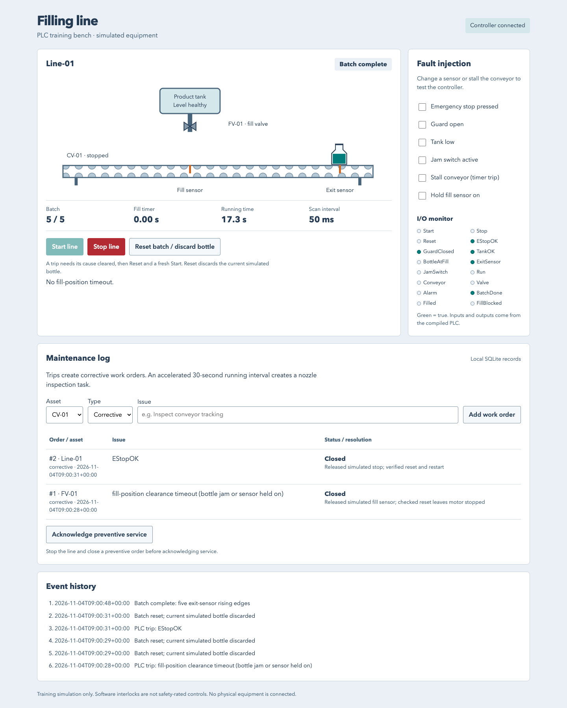

# PLC filling-line training bench

I built a bottle-filling simulator because I wanted to practise stopping a faulty line and getting it running again without needing physical equipment.

## Overview

Clearing an obstruction does not mean a conveyor should start moving again.
I wanted to see that distinction play out: what stops the motor and valve, what
keeps them off, and what I must do before starting a fresh batch.

In this personal project, I run five virtual bottles along a conveyor using a
browser control panel. I can watch them fill, stall the conveyor or open a guard.
Then I clear the cause, reset and start again. A maintenance log records the
repair work and opens a nozzle inspection order after a short practice interval.
I can also hold the fill sensor on to see how the controller handles a bottle
that appears not to leave the filling position.

Follow the setup below, open **http://127.0.0.1:8765**, and press **Start line**.
The panel shows the conveyor, valve, sensors and bottle count. For a quick
terminal walkthrough after building, run `python -m fillingline.practice`.
Everything here is simulated; it does not connect to real equipment.

## Run locally

Requires Python 3.9+, Git and a C/C++ compiler. Install the build tools for your
operating system first. On Ubuntu / Debian:

```sh
sudo apt-get update
sudo apt-get install -y build-essential autoconf automake bison flex python3-venv git
```

On macOS (Apple Silicon Homebrew shown; install Xcode Command Line Tools for the
C/C++ compiler if needed):

```sh
brew install autoconf automake bison flex
export PATH="/opt/homebrew/opt/bison/bin:/opt/homebrew/opt/flex/bin:$PATH"
```

Then get the project and start the panel:

```sh
git clone https://github.com/jackaI1/plc-filling-line.git
cd plc-filling-line
python3 -m venv .venv
. .venv/bin/activate
python -m pip install -r requirements-dev.txt
python tools/build.py
python tools/validate_schema.py
python -m fillingline.server
```

Open **http://127.0.0.1:8765**. Stop with Ctrl+C. Use `--port 8766` if the default
port is occupied. Work orders persist in `.build/maintenance.sqlite3`; use
`--db /path/to/demo.sqlite3` for a separate log. That directory is ignored by Git.
The server accepts connections from this computer only.

The first build downloads the pinned OpenPLC tools into `.build/` and compiles
the controller. It does not install a background service. No Python packages are
needed by the running panel; the build tools use `lxml`.



## Try a fault and recovery

1. Press **Start line**. The conveyor stops each bottle under the valve for a
   one-second fill. The fifth bottle reaching the exit ends the batch.
2. While running, select **Stall conveyor**. After three seconds of commanded
   travel without an exit signal, the line trips and a corrective work order
   appears.
3. Clear the stall. The alarm stays latched until you press
   **Reset batch / discard bottle**. Reset clears the batch and removes the
   current simulated bottle; you must press **Start line** to run again.
4. Enter a resolution and close the work order. Closing an order records the
   work; it does not reset or start the line.
5. Try a low tank, open guard or emergency-stop input. The motor and valve turn
   off in the next simulation step. Reset cannot override an unhealthy input.

Stopping mid-fill also requires a reset and removal of the partly filled bottle.
After 30 seconds of accumulated running time, the log opens a preventive nozzle
inspection order. Stop the line, complete that order and acknowledge service.
This short interval makes the workflow easy to try; it is not a maintenance
recommendation for real equipment.

To follow the conveyor-stall recovery in the terminal instead:

```sh
python -m fillingline.practice
```

It prints the simulated time, motor and valve state, bottle count and work-order
status at each checkpoint. It clears the stall, closes the order, checks that
neither action restarts the line, then resets and starts a full five-bottle batch.
It runs the same compiled controller and plant as the browser, with an isolated
in-memory log. It opens no server and leaves the browser's saved work orders alone.

## Check a bottle that does not leave

I wanted a more useful warning than a general conveyor timeout when a filled
bottle stays under the nozzle. Select **Hold fill sensor on**, then **Start line**.
After the one-second fill, the controller allows one second for the bottle to
leave the sensor. If the signal stays on, it stops the motor and valve and shows
**Fill position did not clear**. The maintenance log opens one work order for
the filling station.

Pressing Reset while the sensor is still held on leaves the fault active, even
though Reset discards the virtual bottle. Release the checkbox, reset, then
start a new batch. Releasing the sensor or closing the work order alone leaves
the line stopped. This same check catches a conveyor stalled at the fill position.
It cannot tell a physical jam from a sensor reading stuck on; the message asks
me to check both.

To run this recovery in the terminal without starting a server:

```sh
python -m fillingline.practice --fault fill-sensor
```

The exercise checks the refused reset, releases the sensor, closes the work
order and completes a fresh five-bottle batch.

## How the controller works

A programmable logic controller (PLC) repeatedly reads sensors and decides
which outputs should run. Here I run that control program on the computer.
Its source is [plc/line.xml](plc/line.xml), a ladder diagram: a drawing of
conditions and on/off decisions, with timers and a bottle counter.

OpenPLC, the controller development tools, exports the diagram to Structured
Text, a text form of controller instructions. The matiec compiler converts it
to code the computer can execute. Python supplies simulated sensor inputs every
50 milliseconds and moves the virtual bottles according to the outputs. The
browser panel, also called a human-machine interface (HMI), shows those
decisions and sends button presses.

See [the ladder diagram](docs/ladder.svg) and
[control and build notes](docs/control-notes.md) for the input/output map,
scan order, toolchain and instructions for changing the ladder.

## Run the checks

After setup, run:

```sh
python -m playwright install chromium
python -m unittest discover -s tests -v
```

Continuous integration (CI), the automated checks GitHub runs for changes,
rebuilds the controller and checks that its exported code matches the ladder.
The 30 tests exercise timed filling, counting, fault recovery, 2,000 randomized input
steps, saved maintenance records, the terminal walkthrough and the browser panel.
They check the fill-clearance timeout at the scan before and exactly at its
one-second limit, output shutdown in that scan, and reset with a sensor held on.
The browser test also checks the panel at desktop and phone widths. It closes its
test page, browser and server and verifies that the server port is closed.

## Scope

This is a personal practice simulation with idealized sensors and virtual time.
It has no physical PLC, connected equipment or hardware safety circuit. It does
not establish dosing accuracy, real-time response or safe control of a machine.
The maintenance log keeps local work orders. It does not provide the wider
scheduling and asset management of a commercial computerized maintenance
management system (CMMS).

Project code is MIT licensed. The OpenPLC editor and matiec compiler keep their
upstream licenses. See [upstream references](docs/control-notes.md#upstream-references).
